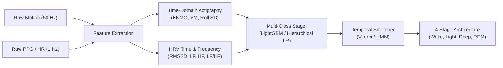
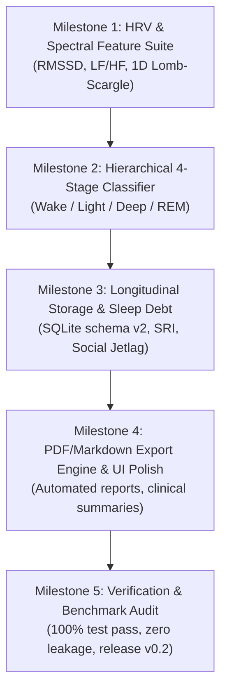

# NoctiBand AI — v0.2 Improvement Scope & Architectural Roadmap

**Document Version:** 1.0.0  
**Authors:** NoctiBand Systems Engineering & Applied ML Teams  
**Target Release:** NoctiBand AI v0.2-alpha  
**Date:** October 2026  
**Status:** Approved for Implementation Planning  

---

## 1. Executive Summary & Current Baseline (v0.1 Audit)

The **NoctiBand AI v0.1** release achieved a fully verified, non-leaking, device-agnostic sleep architecture system:
- **Baseline Binary Staging (`Wake` vs. `Sleep`)**: Trained on 22 curated subjects ($\ge 95\%$ signal coverage, 18,187 epochs), achieving **0.9301 test accuracy**, **0.6466 balanced accuracy**, and **0.4224 Wake F1** on held-out sequestered test subjects (`models/noctiband_v0.1.joblib`).
- **3-Class Exploratory Staging (`Wake`, `NREM`, `REM`)**: Established baseline out-of-fold pooled performance (Balanced Accuracy `0.6208` for Logistic Regression, `0.4854` for Random Forest).
- **Rate-Bias Gating & Physical Domain Invariance**: Validated across heterogeneous sampling frequencies (10 Hz, 33 Hz, 50 Hz) with zero statistically significant rate bias against null bootstraps.
- **Consumer App & SQLite Persistence**: Functional Streamlit interface supporting synthetic demos, multi-night SRI calculation, and habit tracking (`src/noctiband/storage.py`).

### Key Identified Limitations in v0.1:
1. **Coarse-Grained Output**: Staging is currently binary (Wake/Sleep) in production; consumer wearables expect 4 stages (`Wake`, `Light / N1-N2`, `Deep / N3`, `REM`) or AASM 5 stages.
2. **Feature Extraction Scalability**: Current feature generation requires loading entire overnight recordings into memory as single DataFrames; multi-night batches cause high memory consumption.
3. **Absence of True HRV Frequency-Domain Dynamics**: v0.1 heart rate features utilize time-domain statistics (mean, std, range, first/last change), omitting spectral Heart Rate Variability (LF, HF, LF/HF) which provides the primary physiologic marker separating REM from NREM/Deep sleep.
4. **Isolated Longitudinal Persistence**: SQLite tables store scalar summary metrics (`tst_min`, `sleep_efficiency`) but do not persist full compressed hypnograms or compute rolling multi-week sleep debt.

---

## 2. Architectural Audit & Scalability Bottlenecks

### 2.1 Feature Pipeline & Memory Footprint
* **Current State**: `align_night_to_epochs` segments raw continuous timestamps using pandas grouping and rolling operations across 30-second windows.
* **Bottleneck**: In continuous multi-night tracking (e.g., 30–90 days per user), holding contiguous Pandas DataFrames in memory scales poorly ($O(N_{\text{samples}})$ where 50 Hz 3-axis motion yields $\sim 1.3 \times 10^7$ rows per month).
* **v0.2 Optimization**:
  - Implement a chunked epoch generator: streaming raw data in 1-hour buffers rather than holding the entire night in RAM.
  - Vectorize epoch summarization with NumPy strided windows (`as_strided` / 1D rolling reductions) rather than pandas groupby aggregations.

### 2.2 Model Registry & Serialization Decoupling
* **Current State**: `src/noctiband/models/registry.py` bundles scikit-learn pipelines with joblib dumps.
* **Bottleneck**: Versioning and metadata management across different architectures (Linear, Random Forest, Temporal CNN / LightGBM) lack schema-enforced model cards.
* **v0.2 Optimization**: Standardize on an explicit `ModelManifest` schema with checksums, required input feature lists, sample rate bounds, and decision thresholds.

---

## 3. Fine-Grained Sleep Staging (v0.2 Research Scope)



### 3.1 Physiological Discriminators by Sleep Stage
To progress from binary staging to clinical 4-stage and 5-stage classifications without EEG:

| Stage | Muscle Tone / Actigraphy | Autonomic / HRV Signatures | Key Extracted Features |
|:---|:---|:---|:---|
| **Wake (0)** | High motor activity, postural shifts, frequent micro-movements | Sympathetic dominance: elevated HR, depressed RMSSD, high LF/HF ratio | `acc_enmo_mean`, `acc_vm_std`, `hr_mean`, `hr_range` |
| **Light Sleep (N1 + N2)** | Low motor activity, sporadic twitches | Gradual parasympathetic emergence: declining HR, moderate RMSSD | Rolling HR trend, baseline-normalized HR, moderate LF |
| **Deep Sleep / SWS (N3)** | Near-zero somatic motor activity | High vagal (parasympathetic) tone: maximal RMSSD, dominant High Frequency (HF: 0.15–0.40 Hz) power | `hrv_hf_power`, `hrv_rmssd`, `hr_std_w21` (low variability), `acc_enmo_max < threshold` |
| **REM Sleep (REM)** | **Muscle Atonia** (complete absence of voluntary movement) | **Autonomic Storms**: paradoxical sympathetic bursts, erratic HR fluctuations, elevated LF/HF | Absence of motion paired with high short-term HR entropy (`hr_change_abs`, `hrv_sdnn`, `hr_entropy`) |

### 3.2 HRV Feature Engineering Suite for v0.2
1. **Time-Domain HRV**:
   - $\text{RMSSD} = \sqrt{\frac{1}{N-1}\sum_{i=1}^{N-1}(RR_{i+1} - RR_i)^2}$: Sensitive marker of parasympathetic (vagal) activation, peaking in Stage N3.
   - $\text{pNN50}$: Percentage of adjacent beat-to-beat intervals differing by $>50$ ms.
2. **Frequency-Domain HRV (Lomb-Scargle Periodogram)**:
   - **LF Power ($0.04 - 0.15\text{ Hz}$)**: Sympathovagal balance marker.
   - **HF Power ($0.15 - 0.40\text{ Hz}$)**: Pure respiratory sinus arrhythmia (RSA) and vagal tone.
   - **$\text{LF}/\text{HF}$ Ratio**: Primary discriminator between NREM autonomic stability and REM autonomic volatility.
3. **Temporal Context Expansion**:
   - In Phase 10 experiments, extending temporal smoothing windows ($w=21, 41$) improved wake PR-AUC by $+0.0729$.
   - v0.2 will formalize a **Hierarchical Classifier**: Stage 1 isolates Wake vs. Sleep; Stage 2 separates NREM vs. REM; Stage 3 splits Light (N1/N2) vs. Deep (N3).

---

## 4. Multi-Night Longitudinal Architecture & Chronic Metrics

### 4.1 Enhanced SQLite Schema (`v0.2`)
To support weeks and months of habit-sleep interaction tracking, the database schema will expand to store compressed epoch-level hypnograms and rolling sleep debt.

```sql
-- Schema migration for NoctiBand v0.2
ALTER TABLE nights_summary ADD COLUMN hypnogram_compressed BLOB;
ALTER TABLE nights_summary ADD COLUMN deep_sleep_min REAL DEFAULT 0.0;
ALTER TABLE nights_summary ADD COLUMN rem_sleep_min REAL DEFAULT 0.0;
ALTER TABLE nights_summary ADD COLUMN light_sleep_min REAL DEFAULT 0.0;

CREATE TABLE IF NOT EXISTS longitudinal_trends (
    id INTEGER PRIMARY KEY AUTOINCREMENT,
    subject_id TEXT NOT NULL,
    calculated_on TEXT NOT NULL,
    window_days INTEGER NOT NULL DEFAULT 7,
    cumulative_sleep_debt_min REAL NOT NULL,
    sleep_regularity_index REAL NOT NULL,
    weekly_efficiency_cv REAL NOT NULL,  -- Coefficient of variation
    social_jetlag_min REAL DEFAULT 0.0,
    created_at TIMESTAMP DEFAULT CURRENT_TIMESTAMP
);

CREATE INDEX IF NOT EXISTS idx_trends_subject ON longitudinal_trends(subject_id);
```

### 4.2 Chronic Sleep Metrics Formulation
1. **Cumulative Sleep Debt ($D_t$)**:
   $$\text{Debt}_t = \max\left(0, \sum_{i=0}^{k-1} (\text{Baseline Need} - \text{TST}_{t-i})\right)$$
   Where user baseline need defaults to 480 minutes (8.0 hours) or a rolling 30-day median.
2. **Sleep Regularity Index (SRI)**:
   Calculates probability of being in the same state (Sleep vs. Wake) at any two timepoints 24 hours apart:
   $$\text{SRI} = 100 \times \left(\frac{2}{M}\sum_{i=1}^M \mathbb{I}(y_i = y_{i+1440}) - 1\right)$$
3. **Social Jetlag**: Difference in sleep midpoint between workdays and free days.

---

## 5. Automated Consumer & Clinical Export Engine

### 5.1 Export Formats
1. **Consumer Sleep Journal (Markdown & HTML)**:
   - Formatted sleep diary ready for immediate viewing or printing.
   - Includes SRI score, sleep onset/wake times, and actionable non-diagnostic hygiene recommendations.
2. **Clinical Polysomnography Summary (PDF)**:
   - Clean vector hypnogram using `plot_hypnogram`.
   - Complete AASM metrics table (TST, SOL, WASO, SE, Awakenings index).
   - Sensor data coverage audit ($\% \text{ valid epochs}$) and signal quality validation.

### 5.2 Non-Diagnostic Compliance Guardrail
Every generated report must pass the safety validator (`validate_suggestion_safety`), guaranteeing no forbidden terms (`diagnos*`, `apnea`, `insomnia`, `patholog*`, `prescrib*`) enter consumer documents.

---

## 6. Implementation Roadmap & Milestones



| Milestone | Deliverables | Target Timeline | Verification Protocol |
|:---|:---|:---|:---|
| **M1: HRV Pipeline** | `src/noctiband/features/hrv.py` (RMSSD, LF, HF, Poincaré features) | Sprint 1 | Resampling tolerance test; agreement with SciPy periodogram |
| **M2: 4-Stage Model** | Hierarchical classifier; 4-stage validation tables; confusion matrices | Sprint 2 | Inner-fold cross-validation; Macro-F1 $\ge 0.55$ on 4 classes |
| **M3: Longitudinal DB** | Schema migration; sleep debt and SRI calculations in `storage.py` | Sprint 3 | Database migration unit tests; idempotency checks |
| **M4: Export Engine** | PDF / Markdown report generator in `src/noctiband/reporting/export.py` | Sprint 4 | PDF generation test without GUI; safety term assertion |
| **M5: Integration** | Streamlit UI tabs for Multi-Week Trends & Report Download; full test run | Sprint 5 | `pytest` 100% pass; `ruff` 0 errors; final audit signoff |

---

## 7. Conclusion

The **v0.2 Roadmap** builds directly upon the mathematically verified foundations established in Phase 10:
- Preserves **all core contracts** in `docs/INTERFACES.md`.
- Enforces strict participant-level splitting and zero data leakage.
- Transforms NoctiBand from a binary sleep/wake indicator into a comprehensive, 4-stage longitudinal sleep wellness platform.
